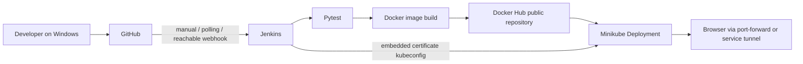

# DevOps Task Manager

A responsive Flask task manager and a local CI/CD lab for Windows 10/11. Add, list, complete, reopen, and delete tasks; the dashboard shows total, pending, and completed counts. Jenkins tests each checkout, builds a uniquely tagged image, pushes it to Docker Hub, deploys to Minikube, and checks the running version.

**Verification status:** see [VERIFICATION.md](VERIFICATION.md) for checks actually run in the authoring environment. A supplied command is not evidence that it succeeded. Docker, Kubernetes, Jenkins, and registry integration require the prerequisites and accounts below.

## Architecture and constraints



Windows runs Docker Desktop in **Linux container mode**, with its WSL 2 backend. The Minikube node and Jenkins are sibling containers on the same Docker network named `minikube`. Jenkins reaches the API at `https://minikube:8443`, using an embedded certificate kubeconfig. A mounted Docker socket gives Jenkins access to the Docker Desktop daemon. This project includes a custom Jenkins image containing Python, Git, Docker CLI, kubectl, and plugins; the standard Jenkins image alone is insufficient.

Tasks live in a Python dictionary and are shared by everyone using this demo. **All data is lost on process restart, redeployment, or pod replacement.** One Gunicorn worker, four threads, a lock, and one Kubernetes replica keep task operations consistent. RollingUpdate uses `maxSurge: 0`, `maxUnavailable: 1`: there is brief downtime, but two independent dictionaries do not serve traffic together. Do not increase worker/replica counts without shared storage.

Stack: HTML/CSS/JavaScript, Python 3.12, Flask, Gunicorn (Linux container), Pytest, Git/GitHub, Jenkins Declarative Pipeline, Docker/Docker Hub, Kubernetes/kubectl, and Minikube. Everything can run locally without paid cloud hosting. Internet access is needed for installers, dependencies, images, plugins, and GitHub/Docker Hub.

## Files

```text
devops-task-manager/
  app.py                 # App factory, validation, locked in-memory API
  requirements.txt
  test_app.py
  Dockerfile
  .dockerignore
  .gitignore
  Jenkinsfile
  README.md
  VERIFICATION.md
  templates/index.html
  static/style.css
  static/script.js
  k8s/deployment.yaml
  k8s/service.yaml
  jenkins/Dockerfile      # Tools and plugins for the local controller
  jenkins/plugins.txt
  scripts/deploy.py       # Render image before apply; Windows/Linux compatible
  scripts/export-kubeconfig.ps1
```

## 1. Windows prerequisites

Use a machine with virtualization enabled and preferably 8 GB RAM or more. All fenced `powershell` blocks run in **Windows PowerShell**, from the project directory unless stated otherwise. Jenkins `sh` steps run in **Linux inside Jenkins**, not PowerShell. Commands with `docker exec ... sh -c` execute that inner command in Linux.

In **Administrator PowerShell**, install/verify WSL 2, then restart when prompted:

```powershell
wsl --install
wsl --update
wsl --set-default-version 2
wsl --status
wsl --list --verbose
```

Existing WSL 1 distributions can be converted using `wsl --set-version Ubuntu 2` (use your actual distribution name). Verify hardware virtualization in Task Manager → Performance → CPU.

Install tools through Windows Package Manager (approve installers as needed):

```powershell
winget --version
winget install --exact --id Docker.DockerDesktop
winget install --exact --id Git.Git
winget install --exact --id Python.Python.3.12
winget install --exact --id Kubernetes.kubectl
winget install --exact --id Kubernetes.minikube
```

Open Docker Desktop and finish setup; enable Settings → General → Use the WSL 2 based engine, and use Linux containers. Reopen PowerShell so PATH changes take effect. Then:

```powershell
python --version
git --version
docker version
docker info --format '{{.OSType}}'
kubectl version --client
minikube version
```

`docker version` must show both client and server; OS type must be `linux`. If winget is missing, install Microsoft's App Installer or use the official installers linked below. Installing only the Docker CLI does not start a daemon.

## 2. Develop and test

Open a terminal in `devops-task-manager`:

```powershell
python -m venv .venv
.\.venv\Scripts\python.exe -m pip install -r requirements.txt
.\.venv\Scripts\python.exe -m pytest -q --junitxml=reports/pytest.xml
.\.venv\Scripts\python.exe app.py
```

No activation or execution-policy change is required. If venv's pip bootstrap fails, use `python -m pip --python .venv\Scripts\python.exe install -r requirements.txt`. In another terminal:

```powershell
Start-Process 'http://localhost:5000'
Invoke-RestMethod http://localhost:5000/health
Invoke-RestMethod http://localhost:5000/version
$task = Invoke-RestMethod http://localhost:5000/api/tasks -Method Post -ContentType 'application/json' -Body '{"title":"Ship the pipeline"}'
Invoke-RestMethod http://localhost:5000/api/tasks
Invoke-RestMethod "http://localhost:5000/api/tasks/$($task.task.id)" -Method Patch -ContentType 'application/json' -Body '{"completed":true}'
Invoke-RestMethod "http://localhost:5000/api/tasks/$($task.task.id)" -Method Delete
```

Stop the development server with Ctrl+C before the Docker run on the same port. Gunicorn uses POSIX APIs and runs in Linux; Windows development uses Flask's development server with debug disabled.

API contract: `GET /api/tasks` returns `{ "tasks": [...] }`; create/update return `{ "task": { "id", "title", "completed" } }`. POST accepts only a title string, trims it, and requires 1–200 characters (201). PATCH accepts only a real boolean `completed` (200). DELETE returns 204. Invalid bodies return JSON 400; missing tasks return 404; bodies over 16 KiB return 413. `/health` returns `{ "status": "healthy" }`; `/version` returns `{ "version": "..." }`.

## 3. Build and run Docker

```powershell
docker build -t task-manager:local .
docker run --rm -p 5000:5000 task-manager:local
```

In another terminal:

```powershell
Invoke-RestMethod http://localhost:5000/health
Invoke-RestMethod http://localhost:5000/version
Start-Process 'http://localhost:5000'
docker images
docker ps
```

Optional detached verification (stop the preceding container first):

```powershell
docker build --build-arg APP_VERSION=demo-1 -t task-manager:demo-1 .
docker run -d --name task-manager-smoke -p 5000:5000 task-manager:demo-1
docker inspect --format '{{.Config.User}} {{.State.Health.Status}}' task-manager-smoke
docker logs task-manager-smoke
Invoke-RestMethod http://localhost:5000/health
Invoke-RestMethod http://localhost:5000/version
docker stop task-manager-smoke
docker rm task-manager-smoke
```

Health becomes `healthy` after its first probe. The image runs as UID 10001, uses Gunicorn, and copies only allowlisted app files. Pytest is included for simplicity; a production image should split test dependencies and pin base images by digest. `APP_VERSION` is configurable at build time or runtime.

## 4. GitHub and Docker Hub

Create an empty GitHub repository in the GitHub UI (for example `devops-task-manager`); avoid adding a generated README to that repository. In this project directory:

```powershell
git init
git add .
git commit -m "Build task manager and local CI/CD pipeline"
git branch -M main
git remote add origin https://github.com/YOUR_GITHUB_USERNAME/devops-task-manager.git
git push -u origin main
```

Authenticate using Git Credential Manager/browser sign-in or a GitHub access token, never a password in the remote URL. Configure your Git name/email if Git asks. The ignore files exclude virtual environments, reports, `.env`, kubeconfigs, and keys. Review `git status` before committing any new file.

In Docker Hub, create a **public** repository named `task-manager`. Generate a Docker Hub personal access token with read/write permissions under account settings. Private registries require imagePullSecrets and are outside this simple setup. In PowerShell, interactive login prompts keep the token out of shell history:

```powershell
docker login --username YOUR_DOCKERHUB_USERNAME
$image = 'YOUR_DOCKERHUB_USERNAME/task-manager:demo-1'
docker build --build-arg APP_VERSION=demo-1 -t $image .
docker push $image
```

Use a new tag for every revision and do not overwrite it. Jenkins uses `build-BUILD_NUMBER-COMMIT` tags; avoid resetting build history or reusing those tags across jobs. `/version` in Jenkins-built images shows that exact build tag, providing a link to both build and commit.

## 5. Start Minikube and deploy manually

Use the default profile **minikube**; scripts and Docker DNS rely on that name:

```powershell
minikube start --driver=docker --kubernetes-version=v1.35.0 --cpus=2 --memory=3072
minikube status
kubectl --context=minikube get nodes
docker network inspect minikube
.\.venv\Scripts\python.exe scripts/deploy.py --image $image --dry-run server
.\.venv\Scripts\python.exe scripts/deploy.py --image $image
kubectl --context=minikube rollout status deployment/task-manager --timeout=180s
kubectl --context=minikube get pods,deployments,services -l app=task-manager
```

The image must already exist in Docker Hub. The committed Deployment contains a placeholder: **do not apply it directly**. `deploy.py` replaces the image in memory and pipes both YAML documents to kubectl. Server dry-run checks API schema/admission before changing cluster state. All resources use the `default` namespace.

For a local image without registry access:

```powershell
docker tag task-manager:demo-1 local/task-manager:demo-1
minikube image load local/task-manager:demo-1
.\.venv\Scripts\python.exe scripts/deploy.py --image local/task-manager:demo-1
```

NodePort exposes service port 5000 on node port 30080. On Windows with the Docker driver, the node IP is usually not directly reachable from the browser. Use:

```powershell
minikube service task-manager --url
```

Keep that terminal open and browse the **returned URL**. Alternatively, use the predictable port-forward in a dedicated terminal:

```powershell
kubectl --context=minikube port-forward service/task-manager 5000:5000
```

In another terminal run `Start-Process 'http://localhost:5000'`, and invoke `/health` and `/version` as above. Stop other apps on port 5000 first. A forward may exit during redeployment; restart it after rollout. `minikube tunnel` is intended for LoadBalancer services; this project's NodePort uses `minikube service` or `kubectl port-forward`.

## 6. Run Jenkins with explicit tool and network access

**Local learning security warning:** Docker socket access allows arbitrary control of the daemon, including mounting host files. Membership in its group is effectively daemon administration. This lab also uses Minikube admin certificates and runs trusted builds on the controller. Bind Jenkins to localhost, use only repositories you control, and never run untrusted pull requests. This architecture is not production-safe; production needs isolated agents, least-privilege namespace RBAC, and controlled image builders.

PowerShell:

```powershell
docker build -t task-manager-jenkins:local --build-arg KUBECTL_VERSION=v1.35.0 -f jenkins/Dockerfile jenkins
docker volume create task-manager-jenkins-home
$socketGroup = (docker run --rm -v /var/run/docker.sock:/var/run/docker.sock alpine:3.21 stat -c '%g' /var/run/docker.sock).Trim()
if ($LASTEXITCODE -ne 0 -or $socketGroup -notmatch '^\d+$') { throw 'Could not inspect Docker socket group.' }
docker run -d --name task-manager-jenkins --restart unless-stopped --network minikube --group-add $socketGroup -p 127.0.0.1:8080:8080 -v task-manager-jenkins-home:/var/jenkins_home -v /var/run/docker.sock:/var/run/docker.sock task-manager-jenkins:local
docker exec task-manager-jenkins docker version
docker exec task-manager-jenkins python3 --version
docker exec task-manager-jenkins kubectl version --client
docker logs task-manager-jenkins
```

The named volume persists users, credentials, plugins, and jobs. Jenkins remains non-root; the extra group matches the socket's actual numeric group. Do not `chmod 666` the socket. Plugin installation occurs during the image build via `jenkins-plugin-cli` and `jenkins/plugins.txt`, including Pipeline, Declarative Pipeline, Git, GitHub, Credentials Binding, Docker Pipeline, and JUnit. Docker Pipeline is available although this pipeline uses the CLI directly. Base/plugin releases are mutable for initial learning setup; record/pin resolved versions for repeatable long-term use.

Open `http://localhost:8080`, unlock it using the following command's output (it is a secret, do not commit/share it):

```powershell
docker exec task-manager-jenkins cat /var/jenkins_home/secrets/initialAdminPassword
```

Finish setup and create an admin user. In Manage Jenkins → Nodes → Built-In Node, configure **one executor** for this lab. Do not configure remote agent jobs for this pipeline unless they have the same tools/network. Only port 8080 is needed; this controller-only demo does not expose an agent port.

## 7. Kubernetes and registry credentials

Export a secret outside the repository:

```powershell
powershell -NoProfile -File scripts/export-kubeconfig.ps1
```

The script exports only the `minikube` context with embedded CA/client certificates, changes the network endpoint to `minikube:8443`, and retains the original host (or existing TLS name) for certificate verification. It does **not** disable TLS verification. This solves both inaccessible Windows certificate paths and host loopback addresses inside Jenkins.

Before uploading, validate the same network route and certificate from a temporary container:

```powershell
$kubeFile = Join-Path $env:TEMP 'task-manager-jenkins-kubeconfig.json'
docker run --rm --network minikube --mount "type=bind,source=$kubeFile,target=/tmp/kubeconfig,readonly" --entrypoint kubectl task-manager-jenkins:local --kubeconfig=/tmp/kubeconfig --context=minikube get nodes
```

Do not proceed to pipeline deployment if this fails. Check the default Minikube profile/network, refresh exported certificates, and inspect DNS/port access. If Minikube is recreated, export and replace the credential again. Jenkins must be connected to the newly created `minikube` network.

In Manage Jenkins → Credentials → System → Global credentials → Add Credentials:

| ID | Kind | Value |
| --- | --- | --- |
| `dockerhub-credentials` | Username with password | Docker Hub username; token in Password |
| `minikube-kubeconfig` | Secret file | Upload the exported JSON file |
| Your optional GitHub ID | Username with password | GitHub username and read-only repository token for private repo checkout |

Missing credential IDs cause Jenkins Credentials Binding to fail with an identifying error; empty image/repository parameters fail at Checkout; blank Docker Hub credentials fail before login. Jenkins masks bound secrets, and the login shell disables tracing. Registry auth is kept in a temporary directory and removed on exit. Kubernetes credentials are bound temporarily outside the browsable workspace.

After upload and successful route verification, remove just the exported file:

```powershell
Remove-Item -LiteralPath $kubeFile
```

The Jenkins volume itself contains secrets: protect it and do not publish volume backups.

## 8. Configure and run the pipeline

1. New Item → `task-manager` → Pipeline.
2. Pipeline definition → **Pipeline script from SCM** → Git.
3. Repository URL: your actual GitHub URL; choose your GitHub credential if private.
4. Branch specifier: `*/main`; Script Path: `Jenkinsfile` (repository root is this project folder).
5. Save and run Build Now once. The initial build registers parameters and will stop with a clear error until required values are set.
6. Build with Parameters: set `GITHUB_REPO_URL`, `GIT_BRANCH=main`, `DOCKER_IMAGE=yourname/task-manager`; set `GITHUB_CREDENTIALS_ID` for private repositories. Run again.

For future builds/polling, retain repository/image defaults by changing the parameter defaults in your own Jenkinsfile, then commit. Never put a token in a default. The SCM job URL/credentials load Jenkinsfile itself; pipeline parameters control its subsequent source checkout. Keep them pointing at the same trusted repo/branch.

Stages: **Checkout → Install Dependencies → Test → Build Docker Image → Push Docker Image → Deploy to Kubernetes → Verify Deployment**. Failed tests stop later stages and publish JUnit XML whenever generated. Deployment first does server dry-run, applies rendered manifests, waits for rollout, port-forwards the service inside Jenkins, probes health, and asserts `/version` equals the immutable tag. Build reports are archived; the job workspace and temporary login/forward resources are cleaned up. It never prunes unrelated Docker images or deletes the cluster. Failed deployment remains visible for diagnosis; rollback is a deliberate operator action.

For logs open job → build number → Console Output; the build page lists Pipeline Steps/stages. Docker/Jenkins logs can be inspected with:

```powershell
docker logs --tail 100 task-manager-jenkins
docker images YOUR_DOCKERHUB_USERNAME/task-manager
kubectl --context=minikube get pods -l app=task-manager
kubectl --context=minikube logs deployment/task-manager --tail=100
kubectl --context=minikube describe deployment task-manager
kubectl --context=minikube rollout status deployment/task-manager --timeout=180s
kubectl --context=minikube get services
kubectl --context=minikube get deployment task-manager -o jsonpath='{.spec.template.spec.containers[0].image}'
```

## 9. Automate triggers and demonstrate a new release

Start manually. For a local-only Jenkins, job → Configure → Build Triggers → **Poll SCM**, schedule `H/2 * * * *` (about every two minutes). Polling makes outbound GitHub requests and works without exposing Jenkins. It builds when the branch changes. After parameter configuration, run successfully once before enabling polling.

GitHub webhooks require a Jenkins HTTPS endpoint reachable by GitHub. `localhost:8080` is not reachable from GitHub. If you have a carefully secured reachable endpoint, enable **GitHub hook trigger for GITScm polling**, and GitHub repo → Settings → Webhooks → payload URL `https://YOUR_REACHABLE_JENKINS/github-webhook/`, JSON, push events. Configure a shared webhook secret through the GitHub plugin's Jenkins settings and GitHub; verify delivery. Do not expose this socket-enabled controller publicly just for a demo. Manual builds and polling are sufficient locally.

End-to-end acceptance checklist (record your actual build numbers and outputs):

1. Run Flask, create/complete/delete a task in the browser, check counts and `/health`.
2. Run Pytest and review JUnit results.
3. Build/run Docker; confirm user 10001, health, and version.
4. Start Minikube; push `demo-1`, render/apply, wait for rollout, open the app.
5. Start Jenkins; verify Docker daemon and Kubernetes route access; configure credentials/job.
6. Trigger Build with Parameters. Confirm all seven stages pass and tag appears in Docker Hub.
7. Start/restart host port-forward; check `/health` and `/version`. Match the version to Jenkins's `build-N-COMMIT` tag and Deployment image.
8. Enable SCM polling. Change `APP_VERSION = "1.0.0"` to `"1.0.1"` in `app.py` and/or change the headline in `templates/index.html`.
9. Run tests, `git add app.py templates/index.html`, `git commit -m "Update release and headline"`, `git push`.
10. Wait for polling (or a verified reachable webhook) to trigger the next build. Confirm a new tag, rollout, headline, and `/version`. In CI, build-time `APP_VERSION` intentionally overrides the source default; the returned build tag changes with the new commit. Old tasks will be gone.

For health/version after the rollout:

```powershell
# Dedicated terminal; keep running.
kubectl --context=minikube port-forward service/task-manager 5000:5000
# Another terminal:
Invoke-RestMethod http://localhost:5000/health
Invoke-RestMethod http://localhost:5000/version
```

## Troubleshooting

| Symptom | Check / solution |
| --- | --- |
| Docker is not recognized | Install Desktop, reopen terminal, start it, verify client and server. |
| Docker Linux socket missing | Switch Desktop to Linux containers; confirm WSL 2 backend. |
| Python venv/ensurepip failed | Use the alternate pip command in section 2; check Python installation and folder permissions. |
| Jenkins socket permission denied | Inspect numeric socket group again; recreate Jenkins container with matching `--group-add`; retain home volume. |
| Jenkins missing tools/plugins | Build/run `jenkins/Dockerfile`, not bare `jenkins/jenkins`; check image-build logs. |
| kubectl connection refused / DNS minikube fails | Start default profile, inspect network, ensure Jenkins is attached with `docker network connect minikube task-manager-jenkins` if necessary. |
| kubectl certificate error | Regenerate flattened kubeconfig after cluster changes, test route before upload; never use insecure TLS bypass. |
| ImagePullBackOff | Repository must be public, tag must exist, username must match; run `kubectl describe pod POD_NAME`. |
| Push denied | Check Docker Hub write token, credential ID, username/repository ownership. |
| Port 5000/8080 busy | Stop earlier server/container or use another host port, e.g. `5001:5000`. |
| NodePort IP does not open | Use `minikube service --url` and keep it running, or use port-forward. |
| Rollout timed out | Inspect pod events/logs, resource availability, image pull, and probes; pipeline stays failed until resolved. |
| Version check fails | Check Deployment image and Jenkins tag; do not reuse immutable tags or override APP_VERSION manually. |
| Tasks disappear or differ | Restarts/deploys reset memory; keep one worker/replica. No persistence/authentication is provided. |
| GitHub does not trigger localhost | Enable SCM polling or manual builds; webhook requires a reachable endpoint. |
| Jenkins GitHub parameters absent | Run once to register them, then use Build with Parameters. |

Useful recovery commands:

```powershell
kubectl --context=minikube get events --sort-by=.metadata.creationTimestamp
kubectl --context=minikube describe pod POD_NAME
kubectl --context=minikube rollout history deployment/task-manager
kubectl --context=minikube rollout undo deployment/task-manager
kubectl --context=minikube rollout status deployment/task-manager
```

Rollback restores the previous image, not task data. Stop the lab with `docker stop task-manager-jenkins` and `minikube stop`; restart with `minikube start` and `docker start task-manager-jenkins`. Do not remove the home volume unless you intend to erase Jenkins configuration. No destructive global Docker cleanup is needed.

## College demo / interview checklist

- Show task creation, completion, deletion, and counts on desktop/mobile.
- Explain REST status codes, isolated tests, and the in-memory limitation.
- Show passing tests and the seven Jenkins stages with an archived report.
- Show non-root container, probes, requests/limits, Deployment, and Service.
- Push a visible headline change; show polling triggering a build and the new `/version`.
- Explain secret credentials, Docker socket risk, localhost webhook limits, and why this uses one worker/replica.
- Describe next steps: database, user authentication, isolated Jenkins agents, scoped RBAC, digest deployments, dependency/security scanning, and durable monitoring.

## Official references

- [Microsoft WSL installation](https://learn.microsoft.com/windows/wsl/install)
- [Docker Desktop on Windows](https://docs.docker.com/desktop/setup/install/windows-install/)
- [Minikube Docker driver](https://minikube.sigs.k8s.io/docs/drivers/docker/) and [local service access](https://minikube.sigs.k8s.io/docs/handbook/accessing/)
- [Jenkins Docker installation](https://www.jenkins.io/doc/book/installing/docker/), [Pipeline syntax](https://www.jenkins.io/doc/book/pipeline/syntax/), and [JUnit publication](https://www.jenkins.io/doc/pipeline/steps/junit/)
- [kubectl TLS server name configuration](https://kubernetes.io/docs/reference/kubectl/generated/kubectl_config/kubectl_config_set-cluster/)
